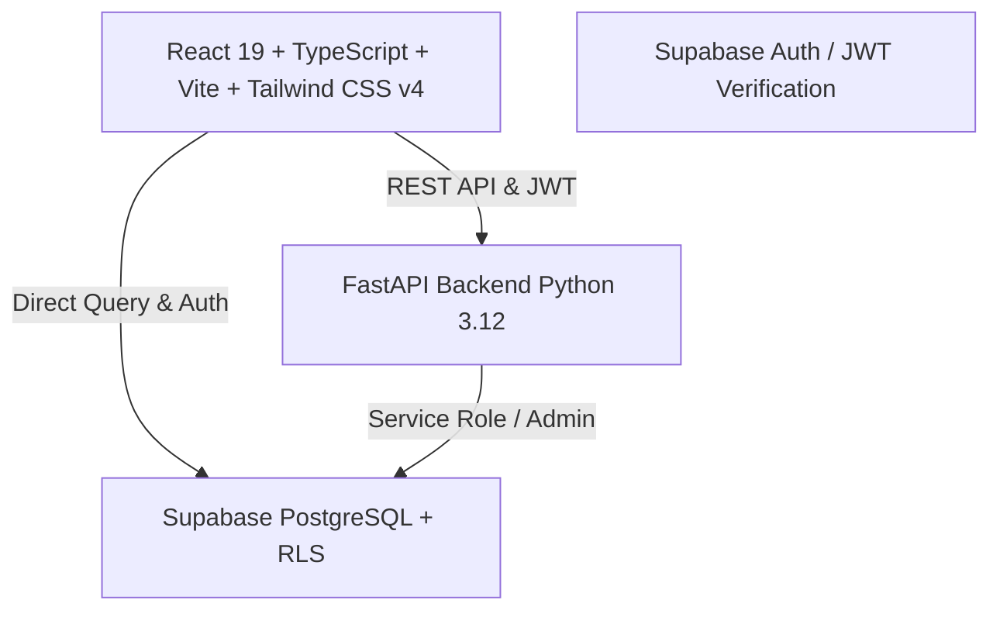
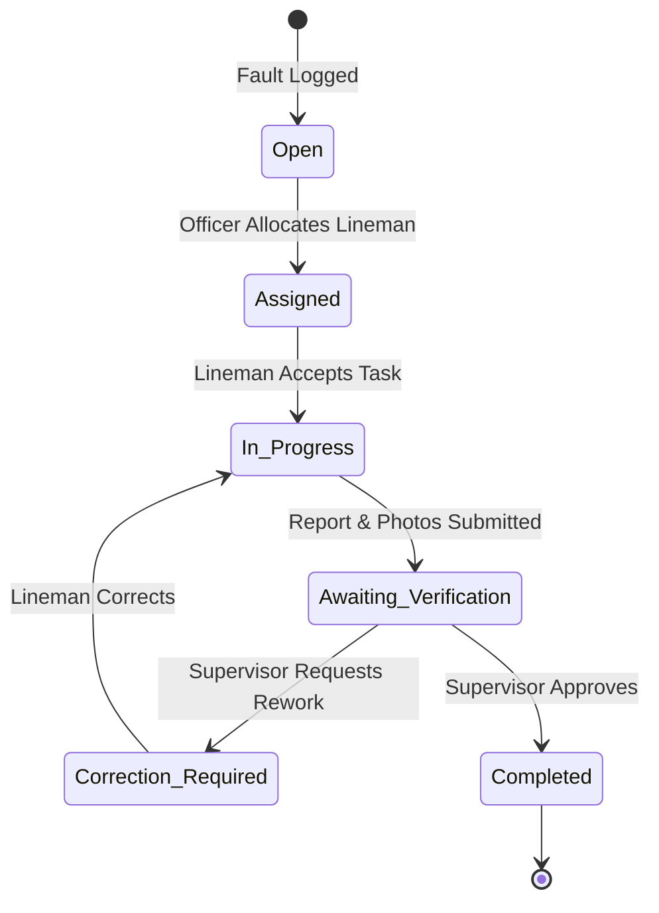

# VIDYUT SPANDAN (ವಿದ್ಯುತ್ ಸ್ಪಂದನ)
## GIS-Enabled Unified Distribution Infrastructure Operations & Maintenance Coordination Platform

**Project:** BESCOM Distribution Operations & Maintenance Coordination Platform  

---

## 1. System Overview

Vidyut Spandan is an enterprise electricity distribution operations and maintenance coordination platform built specifically for Bengaluru, Karnataka. It integrates:

- **GIS Asset Management:** Leaflet & OpenStreetMap geospatial tracking of streetlights, distribution transformers (DTR), and 11kV feeders across BBMP wards.
- **Role-Based Portals:** Dedicated operational dashboards for System Administrator, Department Officer, Field Lineman, and Quality Assurance Supervisor.
- **Maintenance Lifecycle:** Automated end-to-end flow from fault report to work order dispatch, mobile field repair reporting, photographic evidence upload, and supervisor sign-off.
- **Citizen Grievance Redressal:** Public fault reporting portal with instant reference tracking and status updates.
- **Operational Intelligence:** Recharts analytics covering ward-wise uptime, fault trends, and MTTR benchmarking.

---

## 2. Technology Architecture

### Frontend Stack
- **Framework:** React 19 + TypeScript + Vite
- **Styling:** Tailwind CSS v4 with Control-Room Dark Navy Theme
- **Icons:** Lucide React
- **Geospatial GIS:** Leaflet 1.9 + CartoDB Dark Matter tiles
- **Analytics:** Recharts
- **Notifications:** React Hot Toast
- **Routing:** React Router v7

### Backend Stack
- **Framework:** Python FastAPI
- **Validation:** Pydantic v2
- **Server:** Uvicorn
- **Security:** Python-Jose (JWT), Passlib
- **Database:** Supabase PostgreSQL with Row Level Security (RLS)

---

## 3. Role-Based Access Control

| Role | Responsibilities | Key Capabilities |
|------|------------------|------------------|
| **System Administrator** | Overall system administration | User governance, zone/ward config, audit logs, system-wide metrics |
| **Department Officer** | Sub-division operations | Fault review, work order dispatch, lineman allocation, report generation |
| **Field Lineman** | Execution of repairs | Assigned task queue, GPS site coordinates, repair reporting, photo evidence |
| **Supervisor** | Quality Assurance | Verification queue, photographic proof audit, approve / request rework |

---

## 4. Work Order Lifecycle State Machine

---

## 5. Security & Row Level Security (RLS)

- Strict PostgreSQL RLS policies restrict lineman access to their assigned work orders only.
- Department officers and supervisors can only query and mutate records within their designated operational zones.
- All administrative and destructive actions are logged into the immutable `audit_logs` table with timestamp, user ID, and client IP.
